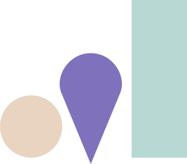

# Navigation

## Principles

Four navigation surfaces — sidebar, topbar, breadcrumbs, tabs — all using the same color and typography vocabulary. Active state is communicated by token contrast (`deep-teal-dim` background, `deep-teal` text) or a 2px accent line. Hover is `shell-warm`. No animated underlines. No drop shadows.

## Tokens / Values

### Sidebar

| Property | Value |
|---|---|
| Width (navigation) | 200–240px |
| Width (detail panel) | 300–360px |
| Background | `shell-warm` or `surface` |
| Active item background | `deep-teal-dim` |
| Active item text | `deep-teal` |
| Hover background | `shell-warm` |
| Item padding | `space-3` vertical, `space-4` horizontal |
| Section labels | Inter 600, `text-xxs`, uppercase, `ink-faint`, letter-spacing 1.5px |
| Item font | Inter 500, `text-sm`, `ink` (active) or `ink-muted` (inactive) |
| Item icon | Phosphor Thin 16–18px |

### Topbar

| Property | Value |
|---|---|
| Height | 48px |
| Background | `surface` |
| Bottom border | `border-light`, 1px solid |
| Padding | `space-4` horizontal |
| Logo position | left |
| Workspace selector | left of center |
| Primary actions | right (icon buttons + avatar) |
| Box-shadow | none |

### Breadcrumbs

| Property | Value |
|---|---|
| Font | Inter 500, `text-xs` |
| Separator | `/` in `ink-faint`, `space-2` margin each side |
| Current crumb color | `ink` |
| Prior crumb color | `ink-muted` |
| Prior crumb hover | `ink`, underline on hover |
| Padding | none — breadcrumbs sit inline above the page heading |

### Tabs

| Property | Value |
|---|---|
| Font | Inter 500, `text-sm` |
| Active text | `ink` |
| Inactive text | `ink-muted` |
| Inactive hover | `ink` |
| Active indicator | 2px solid `deep-teal` underline at the bottom of the tab |
| Padding | `space-3` vertical, `space-4` horizontal |
| Background | none (no pills, no fills) |
| Tab strip border | 1px `border-light` along the bottom edge |

## Semantic Assignment Rules

- **Sidebar active state** uses `deep-teal-dim` background and `deep-teal` text — never an underline or a left-border accent. The dim background reads as "you are here."
- **Section labels** in the sidebar are uppercase at `text-xxs`. They are the only uppercase text in the navigation.
- **Topbar carries logo + workspace context + primary actions only.** Secondary actions live in the sidebar or a settings page.
- **Breadcrumbs are read-only context** above a page heading. The current crumb is not clickable. Prior crumbs are clickable links underlined on hover.
- **Tabs use a 2px `deep-teal` underline**, never a background pill. Underlines do not animate; they appear and disappear instantly between tabs.
- **Icon-only sidebar items** must always carry an accessible label and a tooltip (see `tooltips.md`).

## Examples

### Sidebar item

```html
<a class="sidebar-item" href="/indicators" aria-current="page">
  <ChartLine size={16} weight="thin" />
  <span>Indicators</span>
</a>
```

```css
.sidebar { width: 220px; background: var(--shell-warm); }
.sidebar-item {
  display: flex;
  align-items: center;
  gap: var(--space-3);
  padding: var(--space-3) var(--space-4);
  font: 500 var(--text-sm) Inter, system-ui, sans-serif;
  color: var(--ink-muted);
  text-decoration: none;
}
.sidebar-item:hover { background: var(--shell-warm); color: var(--ink); }
.sidebar-item[aria-current="page"] {
  background: var(--deep-teal-dim);
  color: var(--deep-teal);
}

.sidebar-section-label {
  font: 600 var(--text-xxs) Inter, system-ui, sans-serif;
  text-transform: uppercase;
  letter-spacing: 1.5px;
  color: var(--ink-faint);
  padding: var(--space-3) var(--space-4);
}
```

### Topbar

```html
<header class="topbar">
  <div class="topbar-left">
    
    <select class="workspace-selector">…</select>
  </div>
  <div class="topbar-right">
    <button class="icon-btn"><Bell size={18} weight="thin" /></button>
    <Avatar />
  </div>
</header>
```

```css
.topbar {
  height: 48px;
  background: var(--surface);
  border-bottom: 1px solid var(--border-light);
  padding: 0 var(--space-4);
  display: flex;
  align-items: center;
  justify-content: space-between;
}
```

### Breadcrumbs

```html
<nav class="breadcrumbs" aria-label="Breadcrumb">
  <a href="/projects">Projects</a>
  <span class="sep">/</span>
  <a href="/projects/aperture">Aperture</a>
  <span class="sep">/</span>
  <span aria-current="page">Indicators</span>
</nav>
```

```css
.breadcrumbs {
  font: 500 var(--text-xs) Inter, system-ui, sans-serif;
  display: flex;
  align-items: center;
  gap: var(--space-2);
}
.breadcrumbs a { color: var(--ink-muted); text-decoration: none; }
.breadcrumbs a:hover { color: var(--ink); text-decoration: underline; }
.breadcrumbs [aria-current="page"] { color: var(--ink); }
.breadcrumbs .sep { color: var(--ink-faint); }
```

### Tabs

```html
<div class="tabs" role="tablist">
  <button class="tab" role="tab" aria-selected="true">Overview</button>
  <button class="tab" role="tab">Indicators</button>
  <button class="tab" role="tab">Observations</button>
</div>
```

```css
.tabs {
  display: flex;
  border-bottom: 1px solid var(--border-light);
}
.tab {
  font: 500 var(--text-sm) Inter, system-ui, sans-serif;
  color: var(--ink-muted);
  padding: var(--space-3) var(--space-4);
  background: none;
  border: none;
  border-bottom: 2px solid transparent;
  margin-bottom: -1px;
}
.tab:hover { color: var(--ink); }
.tab[aria-selected="true"] {
  color: var(--ink);
  border-bottom-color: var(--deep-teal);
}
```

## Don'ts

- Don't use a hover background on breadcrumb crumbs — only underline on hover.
- Don't render tabs as full pills with fills — underline only.
- Don't ship icon-only sidebar items without a tooltip.
- Don't animate the tab underline (no slide).
- Don't add a drop shadow to the topbar.
- Don't make the current breadcrumb a clickable link.
- Don't put more than three sections of items in a sidebar — collapse or reorganize first.
